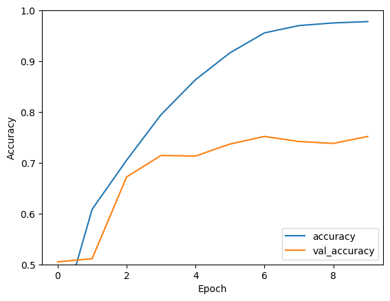
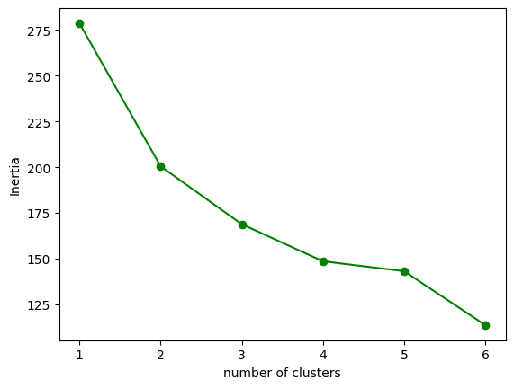
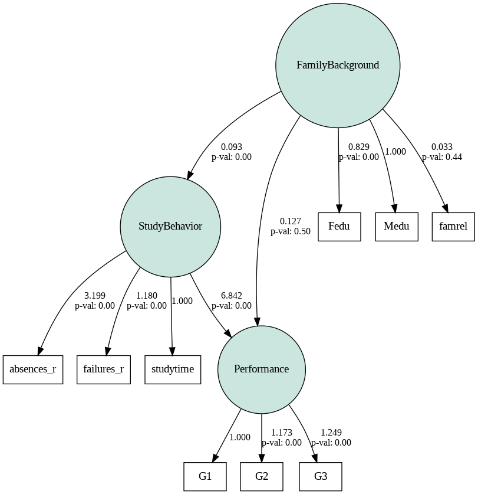

[English](README.md) | **Deutsch**

# KI- und Machine-Learning-Kursprojekte

Praxisorientierte Projekte aus dem KI- und Machine-Learning-Kurs meines Masterstudiums **„Ingenieurwesen und Management
nachhaltiger Technologien" (Schwerpunkt Automobil- und Mobilitätsindustrie)**. Der Kurs war projektbasiert: In jeder
Lehrveranstaltung habe ich ein Projekt mit einem realen Datensatz umgesetzt, um eine neue Methode anzuwenden. Zusammen decken
die Projekte das gesamte ML-Spektrum ab – von Datenvisualisierung und Regression bis zu Deep Learning, Transformern und
Strukturgleichungsmodellierung.

Jedes Notebook beginnt mit einer kurzen Zusammenfassung: Ziel, Daten, Methoden, Ergebnisse und Erkenntnisse.

## Highlights

| | |
|---|---|
| **[Klassifikation von Karosserietypen (CNN)](05-deep-learning/car_body_type_classification_nn_cnn.ipynb)** Ordnet Fahrzeugbilder 7 Karosserietypen zu. Ein CNN erreichte **75,2 %** Testgenauigkeit gegenüber 49,0 % bei einem vollständig verbundenen Netz. |  |
| **[Textklassifikation mit Transformern](06-nlp-transformers/text_classification_transformers.ipynb)** Zero-Shot-Klassifikation mit BART-MNLI ordnete **85 %** der Sätze ohne Trainingsdaten richtig zu; dazu DistilBERT-Embeddings und k-Means. |  |
| **[Strukturgleichungsmodellierung](07-structural-equation-modelling/sem_student_performance.ipynb)** Ein Modell mit latenten Variablen zeigt: Der familiäre Hintergrund wirkt *indirekt* über das Lernverhalten auf die Leistung. |  |

## Inhalt

| Nr. | Thema | Notebook | Methoden | Zentrales Ergebnis |
|---|-------|----------|---------|------------|
| 01 | Datenvisualisierung | [Matplotlib & Seaborn](01-data-visualisation/visualisation_matplotlib_seaborn.ipynb) | Linien-, Streu-, Balken-, Kreis-, Box-, Swarm- und Pairplots; Ausreißererkennung | |
| 01 | Datenvisualisierung | [Umfragekategorien](01-data-visualisation/visualisation_survey_categories.ipynb) | Diagramme für kategoriale Antworthäufigkeiten | |
| 02 | Regression | [Lineare Regression](02-regression/linear_regression.ipynb) | einfache und multiple Regression, Train-Test-Split, MSE, R² | R² 0,71 bei Immobilienpreisen |
| 03 | Klassifikation | [KNN & Entscheidungsbaum](03-classification/knn_and_decision_tree_diabetes.ipynb) | KNN, Wahl von *k*, Entscheidungsbaum, Graphviz | 72,3 % Genauigkeit |
| 03 | Klassifikation / Regression | [Random Forest](03-classification/random_forest_classification_and_regression.ipynb) | Random-Forest-Klassifikator und -Regressor, Konfusionsmatrix, Feature Importance, Gebäudeenergieeffizienz | 73,4 % Genauigkeit |
| 04 | Unüberwachtes Lernen | [k-Means-Clustering](04-unsupervised-learning/kmeans_clustering_wine.ipynb) | k-Means, Clusterzentren, Ellbogenmethode | k ≈ 3 |
| 04 | Unüberwachtes Lernen | [Hauptkomponentenanalyse](04-unsupervised-learning/pca_dimension_reduction.ipynb) | PCA in 2D/3D, Skalierung, erklärte Varianz, Incremental PCA | |
| 05 | Deep Learning | [Karosserietypen: NN vs. CNN](05-deep-learning/car_body_type_classification_nn_cnn.ipynb) | TensorFlow/Keras, neuronales Netz, CNN | **75,2 %** (7 Klassen) |
| 06 | NLP | [Transformer](06-nlp-transformers/text_classification_transformers.ipynb) | Zero-Shot-Klassifikation, Sentimentanalyse, Embeddings + Clustering | **85 %** Zero-Shot |
| 07 | Statistik | [Strukturgleichungsmodell](07-structural-equation-modelling/sem_student_performance.ipynb) | Strukturgleichungsmodellierung mit semopy | signifikanter indirekter Effekt |
| 99 | Kurze Übungen | [KNN](99-practice-exercises/knn_california_housing.ipynb), [k-Means](99-practice-exercises/kmeans_california_housing.ipynb) | Übungen aus dem Unterricht | |

## Erkenntnisse

Rückblickend würde ich diese Punkte heute anders umsetzen – sie sind in echten Projekten entscheidend:
- **Target Leakage:** Bei der Random-Forest-Regression waren die Zielvariablen noch unter den Eingangsgrößen (R² 0,999). Das ist im Notebook vermerkt, inklusive Korrektur.
- **Skalierung der Merkmale** vor distanzbasierten Verfahren (k-Means, KNN, PCA).
- **Overfitting:** Das CNN erreichte rund 97 % Trainings- gegenüber rund 75 % Validierungsgenauigkeit. Nächste Schritte sind Datenaugmentation, Dropout und Transfer Learning.
- **Das passende Modell für die Zielgröße:** Regression für kontinuierliche Werte, Klassifikation für Kategorien.

## Tools

Python · pandas · NumPy · scikit-learn · TensorFlow / Keras · Hugging Face Transformers · semopy · Matplotlib · Seaborn · Plotly · Google Colab

## Notebooks ausführen

Die Notebooks wurden in **Google Colab** ausgeführt. Einige laden Daten aus Google Drive oder über `files.upload()`. Verwendete öffentliche Datensätze:
Pima Indians Diabetes, Boston Housing, UCI Energy Efficiency (ENB2012), UCI Student Performance (über `ucimlrepo`), Wine Clustering, California Housing (Colab-Beispieldaten) sowie ein Bilddatensatz mit Fahrzeugkarosserietypen.

Hinweis: Die Zusammenfassungen in den Notebooks selbst sind auf Englisch.

---
*Nathaniel Takyi Aggrey · [LinkedIn](https://www.linkedin.com/in/nathaniel-aggrey-766a6721b)*
