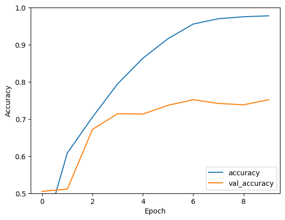
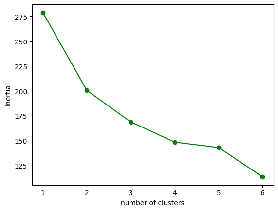
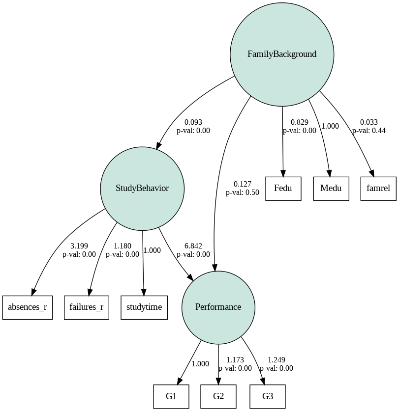

**English** | [Deutsch](README.de.md)

# AI & Machine Learning Course Projects

Hands-on projects from the AI / Machine Learning course of my **M.Eng. in Engineering & Sustainable Technology
Management (Mobility & Automotive Industry)**. The course was project-based: every class, I built and ran a project
on a real dataset to practise a new method. Together the projects cover the full ML toolkit, from data visualisation and
regression to deep learning, transformers and structural equation modelling.

Each project notebook starts with a short summary: goal, data, methods, results and takeaways.

## Highlights

| | |
|---|---|
| **[Car body type classification (CNN)](05-deep-learning/car_body_type_classification_nn_cnn.ipynb)** Classifies car images into 7 body types. A CNN reached **75.2%** test accuracy vs. 49.0% for a dense network. |  |
|  **[Transformers for text classification](06-nlp-transformers/text_classification_transformers.ipynb)** Zero-shot classification with BART-MNLI labelled **85%** of sentences correctly with no training data; DistilBERT embeddings + K-means. |  |
| **[Structural equation modelling](07-structural-equation-modelling/sem_student_performance.ipynb)** Latent-variable model showing family background affects performance *indirectly* via study behaviour. |  |

## Contents

| # | Topic | Notebook | Methods | Key result |
|---|-------|----------|---------|------------|
| 01 | Data visualisation | [Matplotlib & Seaborn](01-data-visualisation/visualisation_matplotlib_seaborn.ipynb) | line, scatter, bar, pie, box, swarm and pair plots; outlier detection | |
| 01 | Data visualisation | [Survey categories](01-data-visualisation/visualisation_survey_categories.ipynb) | categorical charts from response counts | |
| 02 | Regression | [Linear regression](02-regression/linear_regression.ipynb) | simple & multiple regression, train/test split, MSE, R² | R² 0.71 on house prices |
| 03 | Classification | [KNN & decision tree](03-classification/knn_and_decision_tree_diabetes.ipynb) | KNN, choosing *k*, decision tree, Graphviz | 72.3% accuracy |
| 03 | Classification / regression | [Random forest](03-classification/random_forest_classification_and_regression.ipynb) | random forest classifier & regressor, confusion matrix, feature importance, building energy efficiency | 73.4% accuracy |
| 04 | Unsupervised | [K-means clustering](04-unsupervised-learning/kmeans_clustering_wine.ipynb) | K-means, centroids, elbow method | k ≈ 3 |
| 04 | Unsupervised | [PCA](04-unsupervised-learning/pca_dimension_reduction.ipynb) | PCA 2D/3D, scaling, explained variance, Incremental PCA | |
| 05 | Deep learning | [Car body type NN vs. CNN](05-deep-learning/car_body_type_classification_nn_cnn.ipynb) | TensorFlow/Keras, dense NN, CNN | **75.2%** (7 classes) |
| 06 | NLP | [Transformers](06-nlp-transformers/text_classification_transformers.ipynb) | zero-shot classification, sentiment analysis, embeddings + clustering | **85%** zero-shot |
| 07 | Statistics | [SEM](07-structural-equation-modelling/sem_student_performance.ipynb) | structural equation modelling with semopy | significant indirect effect |
| 99 | Short exercises | [KNN](99-practice-exercises/knn_california_housing.ipynb), [K-means](99-practice-exercises/kmeans_california_housing.ipynb) | in-class exercises | |

## Lessons learned

Looking back at these projects, these are the points I would now handle differently, and they matter in real projects:
- **Target leakage:** the random forest regression kept the target columns among the features (R² 0.999). This is noted and the fix is shown in the notebook.
- **Feature scaling** before distance-based methods (K-means, KNN, PCA).
- **Overfitting:** the CNN reached ~97% training vs. ~75% validation accuracy. Next steps are data augmentation, dropout and transfer learning.
- **The right model for the target:** a regressor for continuous targets, a classifier for categories.

## Tools

Python · pandas · NumPy · scikit-learn · TensorFlow / Keras · Hugging Face Transformers · semopy · Matplotlib · Seaborn · Plotly · Google Colab

## Running the notebooks

The notebooks were run in **Google Colab**. Some load data from Google Drive or via `files.upload()`. Public datasets used:
Pima Indians Diabetes, Boston Housing, UCI Energy Efficiency (ENB2012), UCI Student Performance (via `ucimlrepo`), Wine clustering, California housing (Colab sample data), and a car body type image dataset.

---
*Nathaniel Takyi Aggrey · [LinkedIn](https://www.linkedin.com/in/nathaniel-aggrey-766a6721b)*
